I've taken 116 engineering courses, or I will have by the end of my master's. Two countries, two universities, three degrees: a B.Eng and an M.Eng in Electrical and Electronic Engineering at the University of Bamenda in Cameroon, and now an MSc in Mechatronics at Ashesi University in Ghana, in partnership with ETH Zurich.

This post lists every single one of them, year by year. Along the way I'll tell you which ones I failed, which ones I aced, the one I loved most, and the ones that kept following me around.

If you'd rather watch than read, there's a video version on my YouTube channel, relaxedTutor:



## At a glance

Seven years of study, 108 courses done by the end of this academic year, and 116 by the end of the program.

| Years | Degree | University | Courses |
| --- | --- | --- | --- |
| 2018 to 2022 | B.Eng Electrical and Electronic Engineering | University of Bamenda, Cameroon | 77 |
| 2022/2023 | M.Eng Electrical and Electronic Engineering | University of Bamenda, Cameroon | 10 |
| 2025 to 2028 | MSc Mechatronics Engineering | Ashesi University, Ghana (with ETH Zurich) | 29 |

One thing changed completely along the way. In Cameroon I took 11 to 13 courses at the same time, spread over a semester. At Ashesi I take one course at a time. Each one runs for about four weeks, ends with an exam, and then the next one starts. I'll come back to that in Year 6.

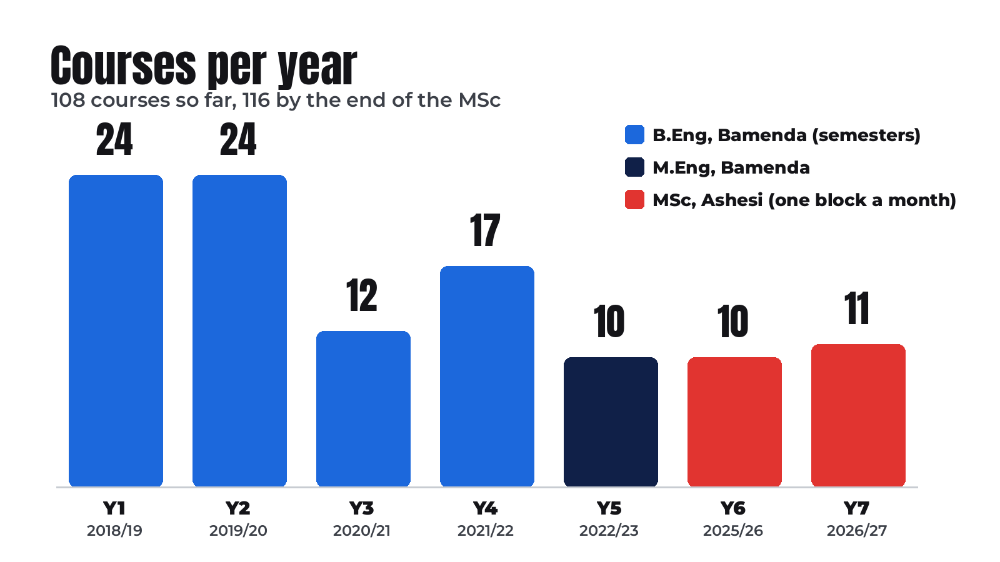

## Year 1 (2018/2019): 24 courses

I'm Cameroonian, and in 2018 I started Electrical and Electronic Engineering at the University of Bamenda. The first year was mostly general: maths, physics, chemistry, drawing and mechanics. Cameroon is bilingual, so we also took Functional English and Functional French. Course number one was Introduction to Engineering, and I enjoyed it.

#### Semester 1

1. Introduction to Engineering
2. Engineering Mechanics I
3. Engineering Drawing I
4. Linear Circuit Analysis
5. Chemistry for Engineers I
6. Physics for Engineers I
7. Engineering Mathematics 1
8. Introduction to Computer Science
9. Intellectual Property Rights
10. Functional English I
11. Functional French I
{: .courses}

#### Semester 2

12. Engineering Mathematics 2
13. Algorithm and Programming Languages
14. Electrical and Electronic Measurement
15. Engineering Mechanics II
16. Engineering Drawing II
17. Enterprise and Organizational Behaviour
18. Chemistry for Engineers II
19. Physics for Engineers II
20. Functional English II
21. Functional French II
22. Civics and Ethics
23. Sports
24. Industrial Attachment I
{: .courses start="12"}

### The C

My first programming course, Algorithm and Programming Languages, ended in a C. But that C has a story. I couldn't write the midsemester test because there was shooting in town, so I could only write the exam. The test was worth 30% of the grade and the exam 70%, so I got a zero on the test. That's how I ended up with a C.

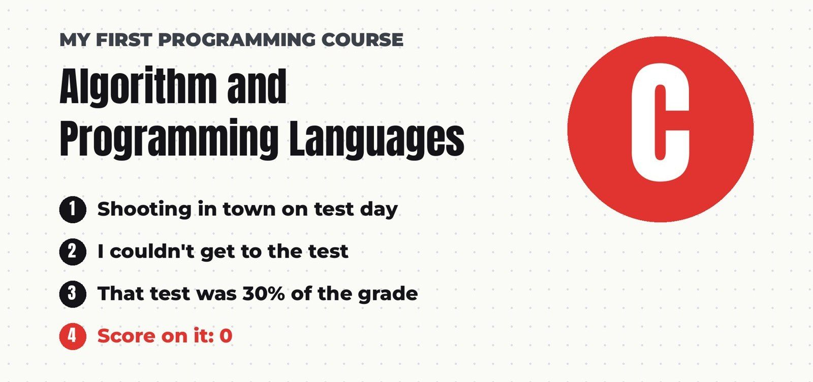

Then there was chemistry. I failed Chemistry for Engineers II and had to resit it. Not glamorous, but that was year one.

## Year 2 (2019/2020): 24 courses

Another 24, and this is where it turned electrical: Electrical Machines, Logic Circuits, Power Electronics, Microprocessors and Computer Aided Design.

#### Semester 1

25. Computer Aided Design
26. Electrical Machines I
27. Programming C++
28. Electronic Devices and Circuits
29. Material Science for Electrical and Electronic Engineering
30. Strength of Materials
31. Engineering Thermodynamics
32. Mechanics of Machines
33. Computer Architecture
34. Exploratory Project I
35. Fluid Mechanics
36. Engineering Maths 3
{: .courses start="25"}

#### Semester 2

37. Engineering Maths 4
38. MATLAB Programming
39. Logic Circuits
40. Power Electronics I
41. Electromagnetic Theory
42. Electrical Machines II
43. Manufacturing Technology
44. Exploratory Project II
45. Engineering Ethics
46. Microprocessors
47. Laboratory Practice I
48. Industrial Attachment II
{: .courses start="37"}

### From a C to an A

This year I took Programming C++, sat every test, and got an A. So that C from year one was never really about programming.

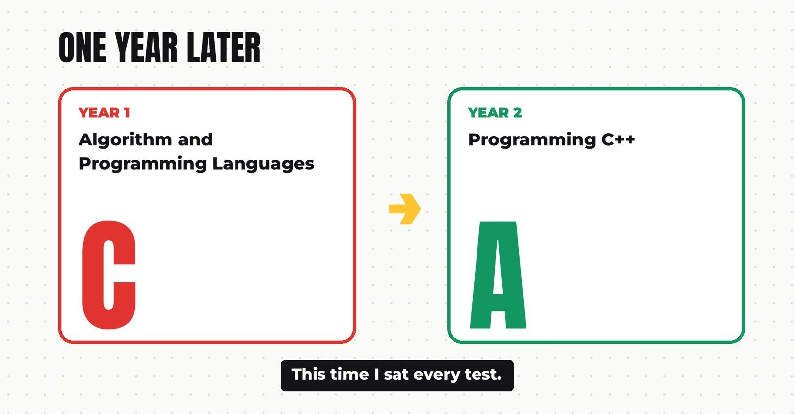

### Current flow vs heat flow

Engineering Thermodynamics was a different story. I understand current flowing through a wire. Heat flowing through a body felt like another language. I barely passed.

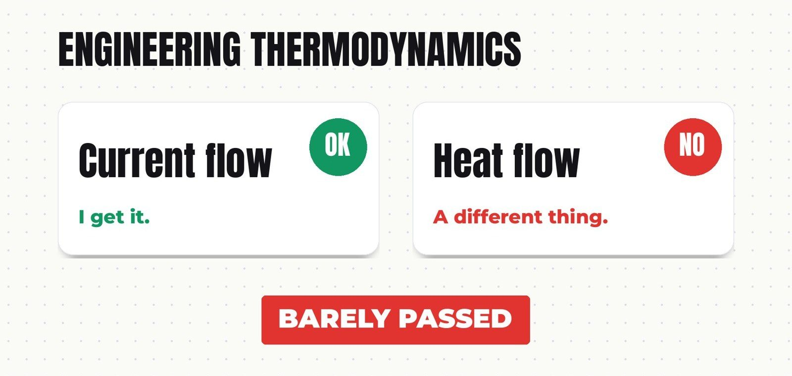

One more course to remember from this year: Manufacturing Technology, a small two-credit course. It shows up again much later.

## Year 3 (2020/2021): 12 courses

Only 12 courses on paper, because the whole second semester was industrial attachment.

#### Semester 1

49. Design Project
50. Microcontrollers and Applications
51. Wireless and Mobile Communications
52. PLC and Applications
53. Power Systems I
54. Instrumentation and Measurement
55. Linear Control Systems
56. Probability and Statistics for Engineers
57. Embedded Systems
58. Signals and Systems
59. Laboratory Practice II
{: .courses start="49"}

#### Semester 2

60. Industrial Attachment III
{: .courses start="60"}

### Six months at a company

For the attachment I spent about six months at a company. Most of the job was splicing optical fibres, and I also maintained base transceiver stations.

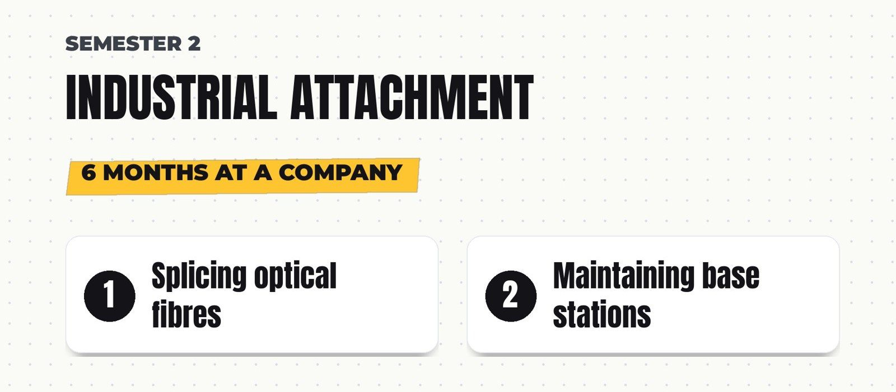

### A hands-on year

The first semester was the practical one: microcontrollers, embedded systems and PLCs. Things you can actually build and wire up. I built a heater controller in undergrad with Wi-Fi and Bluetooth control, housed in a plywood casing.

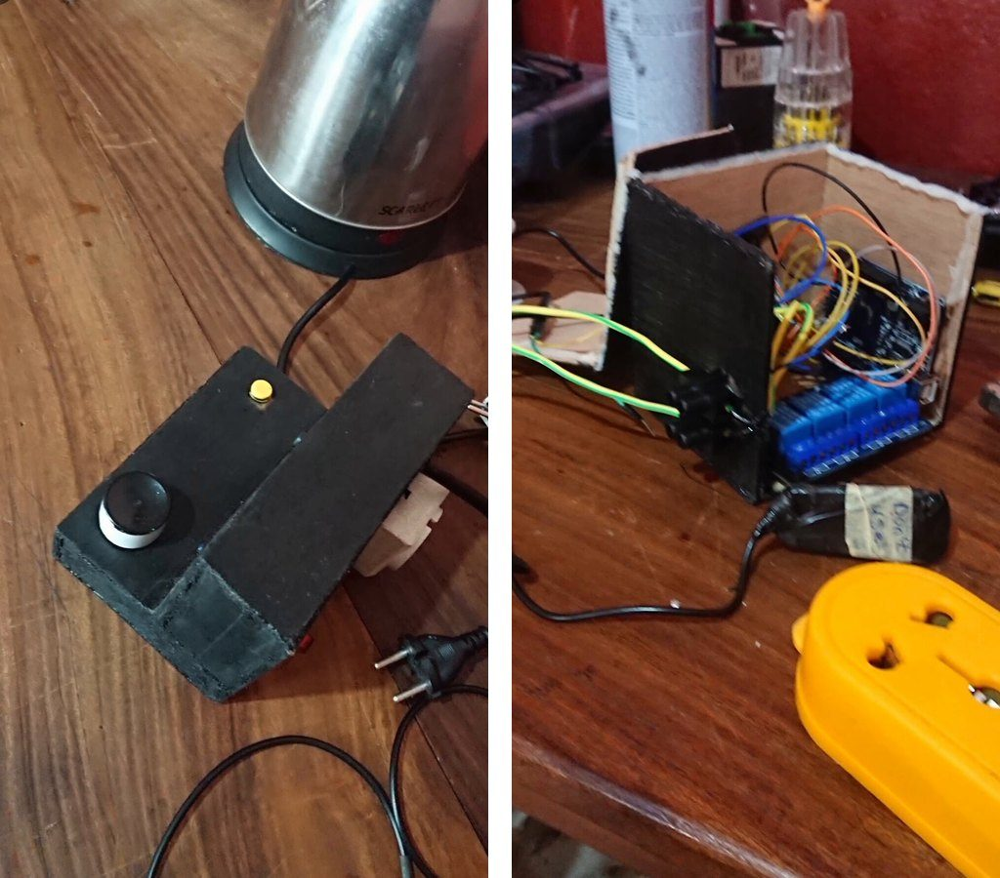
*The heater controller, and the wiring inside its plywood box.*

This is also where I met Linear Control Systems, my first proper control course. Keep count, because control comes back again and again. So does Signals and Systems.

## Year 4 (2021/2022): 17 courses

The final year of the bachelor's, and where it specialised.

#### Semester 1

61. Power Electronics II
62. Feedback Control Systems
63. Engineering Economics
64. Research Methods
65. Renewable Energy Systems
66. Industrial Automation
67. Digital Electronics
68. Engineering Management
69. Professional and Technical Communication
70. Entrepreneurship
71. Laboratory Practice III
{: .courses start="61"}

#### Semester 2

72. Special Topics in Automation and Control
73. Seminars
74. Power Systems II
75. Special Topics in Telecommunications
76. Laboratory Synthesis Project
77. Research Project
{: .courses start="72"}

### Two 100s

I scored 100 in both Power Electronics II and Power Systems II. Feedback Control Systems and Special Topics in Automation and Control took my control count to three. And Entrepreneurship showed up for the first time.

### The fingerprint payment system

My research project was a fingerprint payment system. Users create a virtual account on a website and top it up. To pay, you place your finger on the device, it recognises you, and the amount is deducted from your account. The device talks to the website over Wi-Fi and sends the receipt by SMS through a GSM module.

I built both the hardware and the website. There was no proper lab and not much equipment. There was no 3D printer either, so I designed the casing in SolidWorks, cut the shapes out of plywood and spray painted it. I wrote the API in PHP from scratch and my own Arduino libraries for the parts, including DatabaseOnSD, which is now public on [GitHub](https://github.com/divinofire/DatabaseOnSD). I wrote the whole build up in a separate post: [Building the Fingerprint Payment System](/posts/fingerprint-payment-system/).

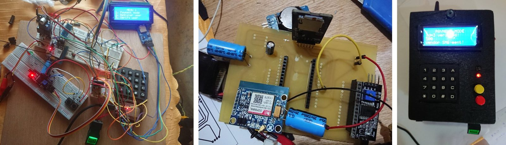
*From breadboard, to my own PCB, to the finished device.*

It took nine months and it was very stressful. When it was over I didn't touch code for a while. But I got it done, defended it with an excellent grade, and the bachelor's was finished: four years, 77 courses.

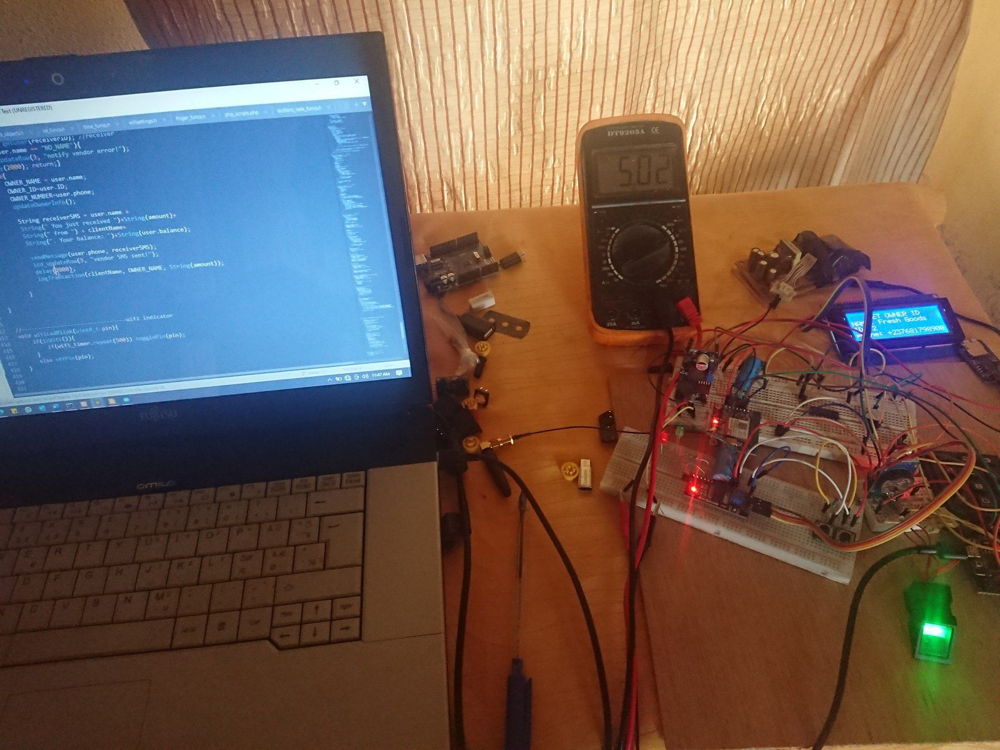
*No proper lab: my workbench during the build.*

## Year 5 (2022/2023): 10 courses

Then I continued with a one-year Master of Engineering at the same university.

#### Semester 1

78. Power Systems Operation and Control
79. Engineering Safety and Health
80. Power Electronics and Renewable Energy Systems
81. Engineering Research and Scientific Writing
82. Advanced Power Systems Analysis
83. Artificial Intelligence and Soft Computing
84. Entrepreneurship
{: .courses start="78"}

#### Semester 2

85. Seminar 1: Research Project Proposal
86. Seminar 2: Pre-Defence Seminar
87. Professional (M.Eng) Dissertation
{: .courses start="85"}

Power Systems Operation and Control was control course number four. And yes, Entrepreneurship again.

### AI then and now

Artificial Intelligence and Soft Computing was my first real look at AI, and it was all theory, not hands-on. Looking back now is a little crazy. In class we talked about AI like a future thing. Today it's everywhere and people use it every day. Things have changed.

### A separator and a long wait

For my dissertation I designed a control system for a two-phase separator, the vessel that separates liquid from gas. It was all done in MATLAB simulation.

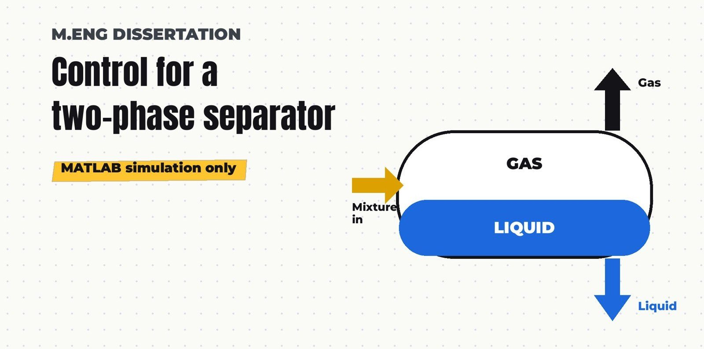

Then graduation got postponed, and we had to wait an extra year to graduate, until December of the following year. I spent that time at home on small projects and applying to schools. I had a few options, and in the end I chose Ashesi. That was the end of my time studying in Cameroon.

## Year 6 (2025/2026): 10 blocks

New country, Ghana. New field, mechatronics, at Ashesi University in partnership with ETH Zurich.

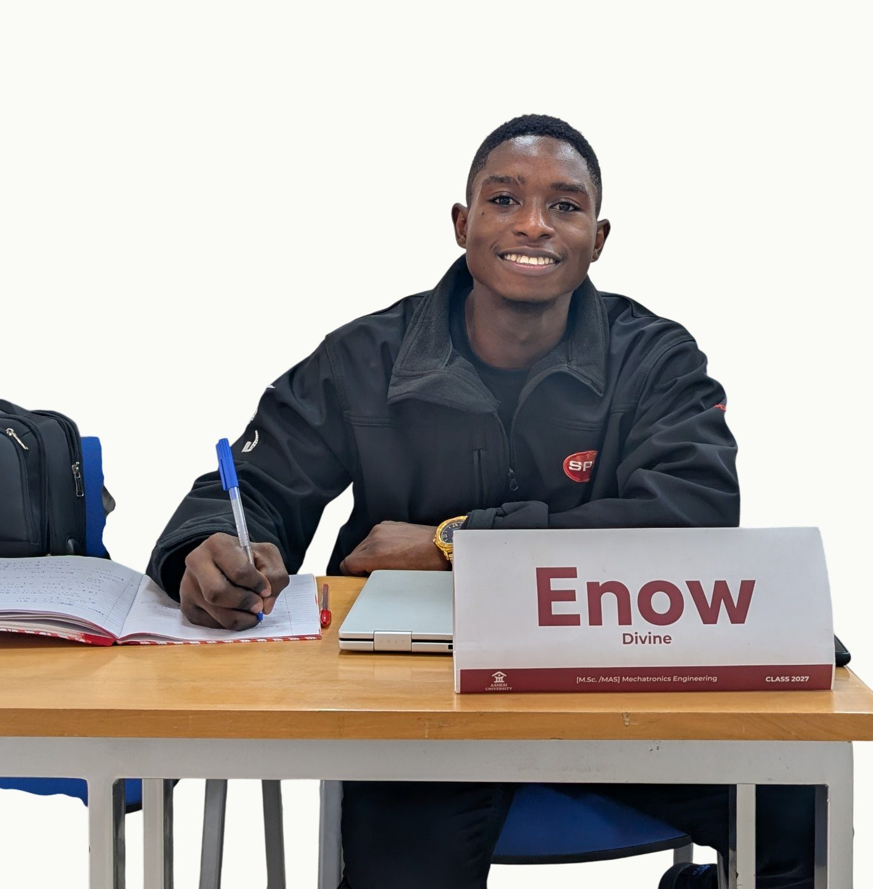

### Why mechatronics?

I was used to controlling electrons. But what about mechanical parts, and how do you link the two? That's exactly what mechatronics is about.

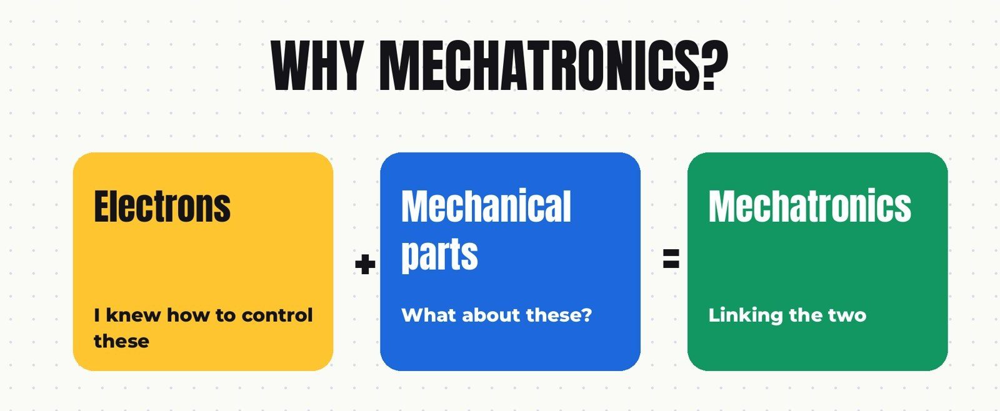

### One course a month

The system here is completely different. There are no semesters. We take one course at a time, called a block. Each block runs for about four weeks, ends with an exam, and then the next one starts. Fall behind for a couple of days and you feel it, but you also go much deeper than you can while juggling twelve courses at once.

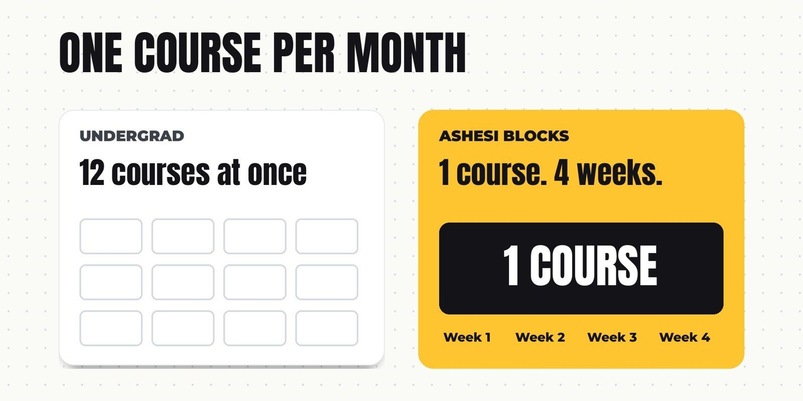

88. Mathematical Tools I: Advanced Calculus
89. Analog and Digital Electronics
90. Signals and Systems
91. Thermofluids
92. Computer Programming and Embedded Systems
93. Mathematical Tools II: Advanced Multivariate Calculus
94. Statics and Solid Mechanics
95. Material Engineering
96. Dynamics
97. Computational Methods
{: .courses start="88"}

We started with Advanced Calculus, which was really mostly linear algebra. It was a good course, and a relaxing one. Then Signals and Systems again, for the second time.

### My favourite course

My favourite course of all of them was the last block of the year, Computational Methods. It wasn't the usual numerical methods course about finding roots of equations or solving differential equations. It was finite element analysis: simulating stress across mechanical parts. I really loved it.

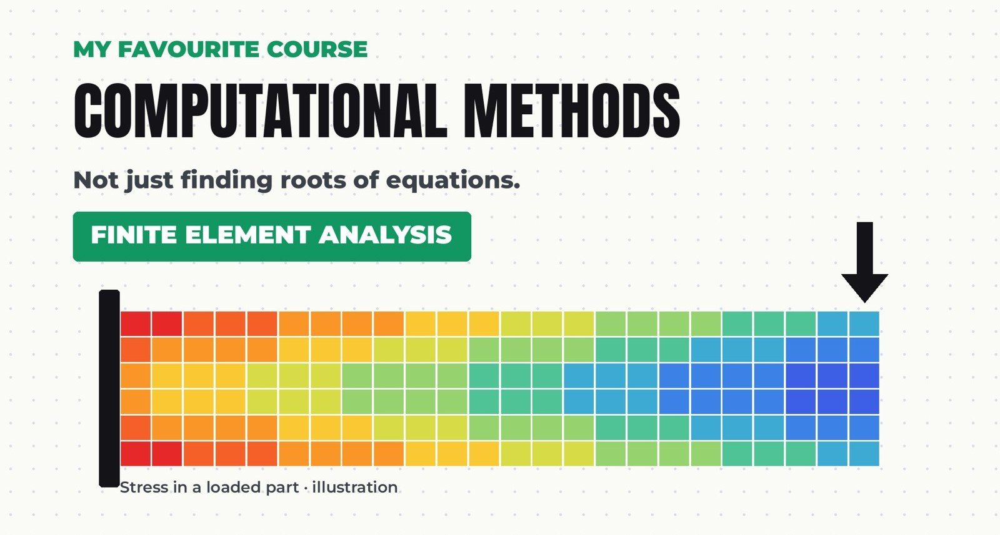
*An illustration of a stress map in a loaded part, the kind of result FEA gives you.*

## Year 7 (2026/2027): 11 blocks

Which brings us to now, the second year of the master's.

98. Analysis and Design of Control Systems (Control Systems I)
99. Industrial Automation
100. International Environmental Politics
101. Renewable Energy Technologies
102. Data Analysis and Machine Learning
103. Convex Optimization
104. Robotics and Mechatronics
105. Corporate Responsibility and Sustainability
106. Energy Systems and Mobility
107. Manufacturing Processes
108. Optimal Control (Control Systems II)
{: .courses start="98"}

The year opened with Control Systems I, control course number five. Then Industrial Automation, which I had already taken in undergrad. And course number one hundred? Not robotics. International Environmental Politics.

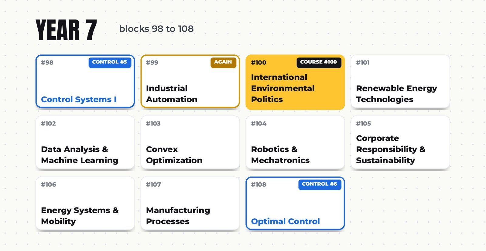

### Then the robots came

In Robotics and Mechatronics we programmed a ball-balancing platform in class. While working with it, I asked myself whether I could add an iterative learning controller, a controller that gets a little better every time it repeats the same task. So I did. We also worked with a VEX robot.

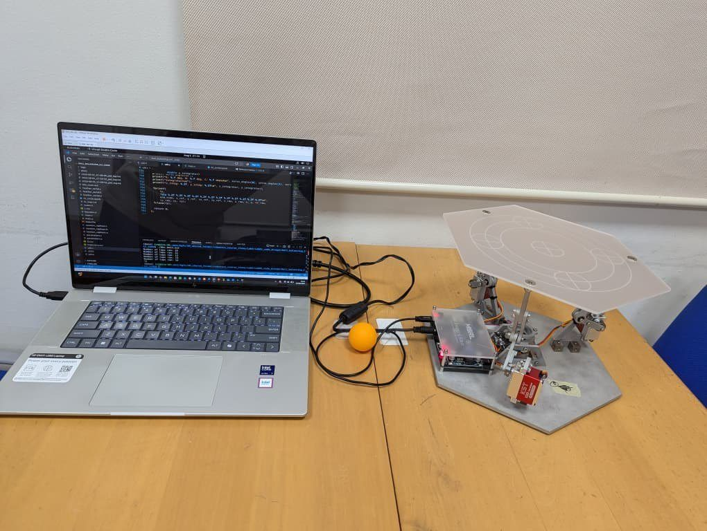
*The ball-balancing platform we programmed in class.*

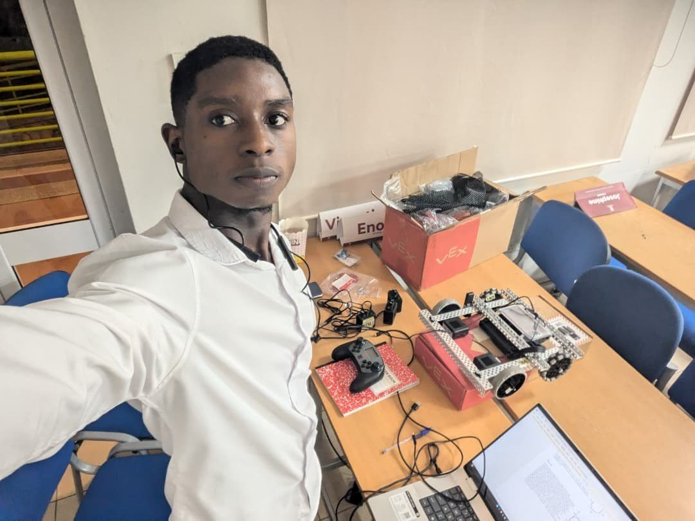
*Setting up the VEX robot.*

### Coming back around

We just finished Manufacturing Processes, years after that small Manufacturing Technology course in undergrad. The year ends with Optimal Control, control course number six.

### Still to come

One more year of the MSc, which brings the total to 116:

109. Reliability and Risk
110. Communication Networks and Internet of Things
111. Development Economics
112. Sustainable Engineering
113. Product Development
114. Internship
115. Applied System Engineering
116. Master Thesis
{: .courses start="109"}

## The courses that kept coming back

Across 116 courses, some topics followed me from Cameroon to Ghana.

| Topic | Times | Where |
| --- | --- | --- |
| Control | 6 | Linear Control Systems (B.Eng Y3); Feedback Control Systems and Special Topics in Automation and Control (B.Eng Y4); Power Systems Operation and Control (M.Eng); Control Systems I and Optimal Control (MSc) |
| Signals and Systems | 2 | B.Eng Y3, MSc Y1 |
| Industrial Automation | 2 | B.Eng Y4, MSc Y2 |
| Manufacturing | 2 | Manufacturing Technology (B.Eng Y2), Manufacturing Processes (MSc Y2) |
| Entrepreneurship | 2 | B.Eng Y4, M.Eng |
{: .topics}

Control is the clear thread. Six courses across three degrees.

## Will people still care to learn?

That's every course I've taken so far. But with AI doing more of the thinking for us, I've started to wonder if people will still care to learn this stuff, or just give up on it.

If you still care, join me as I unpack what I've learned over the years, one post and one video at a time. You'll find the posts here, and the videos on YouTube as relaxedTutor.

Which course would you want me to unpack first? Tell me in the comments under [the video](https://www.youtube.com/watch?v=K4A9s5yN2-w).
