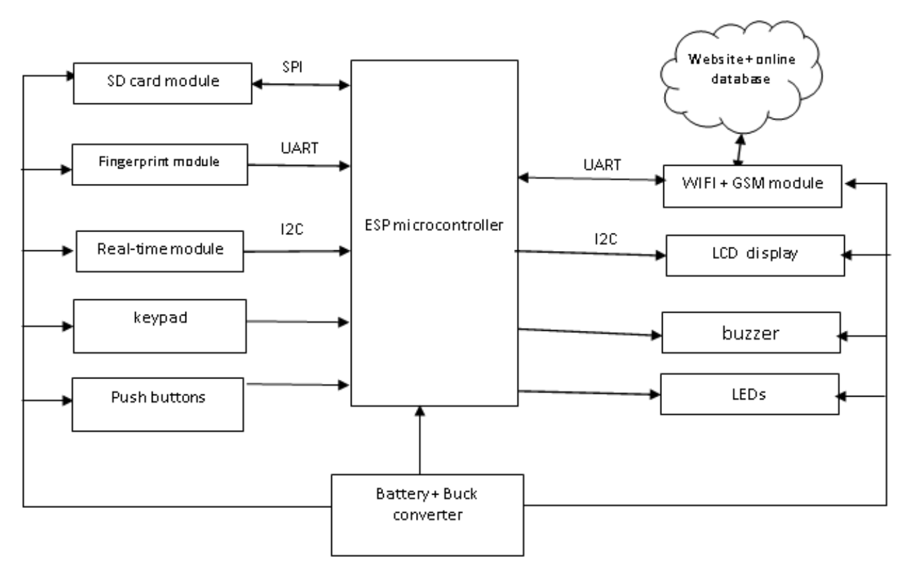
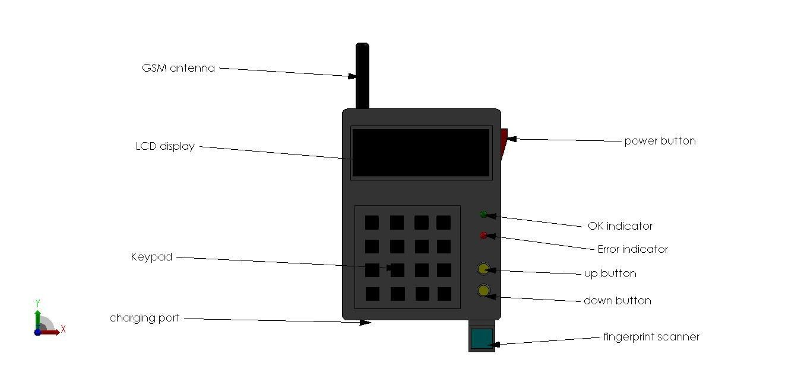
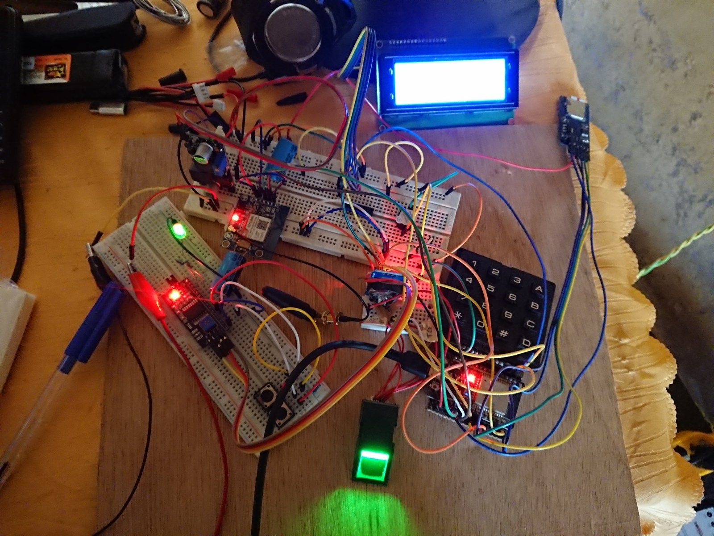
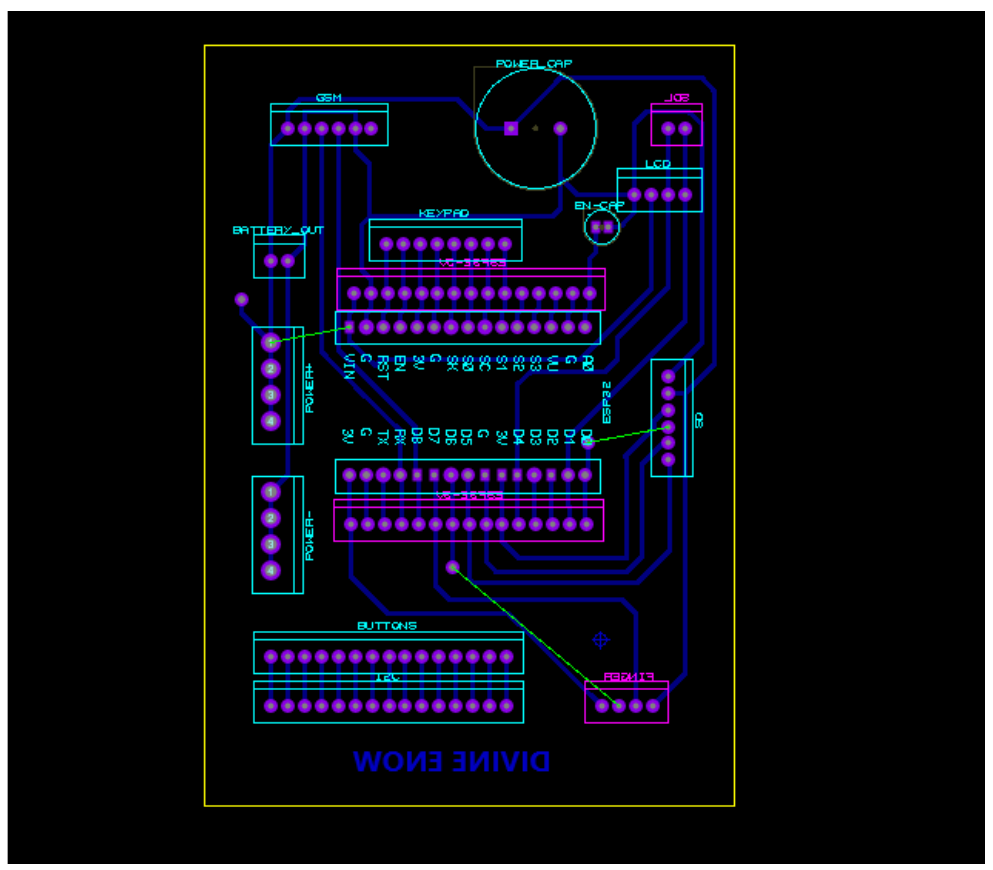
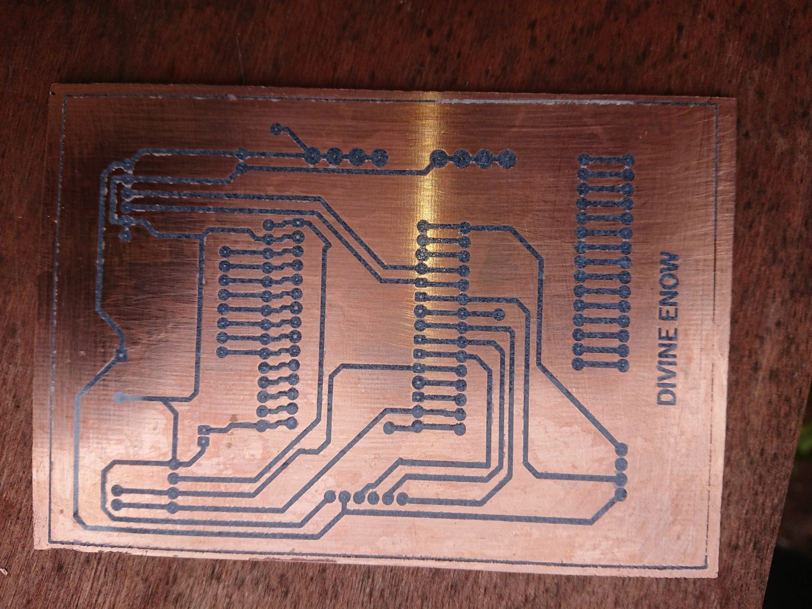
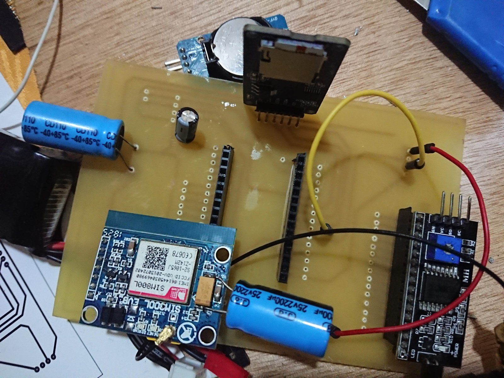
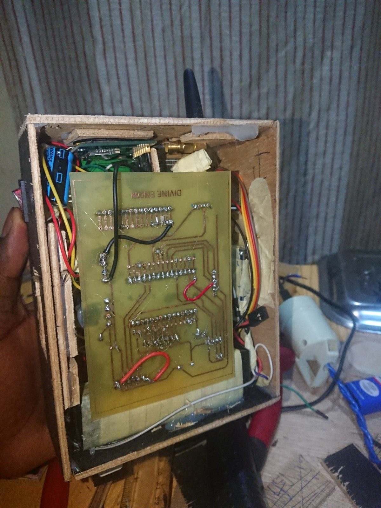
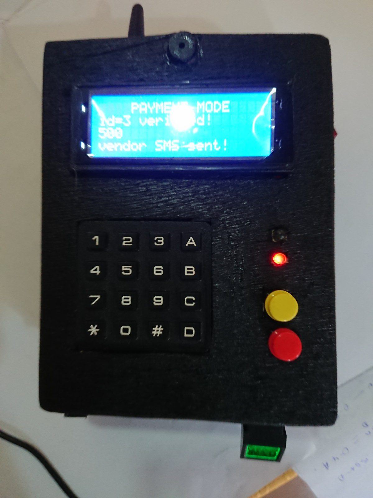
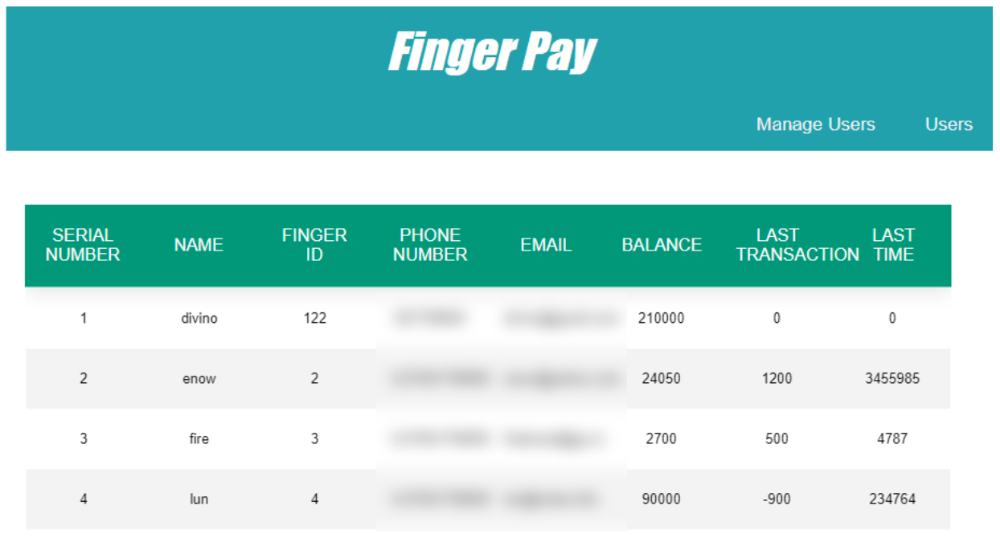

## Overview

My B.Eng final year project at the University of Bamenda was a fingerprint payment system. It took 9 months, I built every part of it myself, and I defended it with an excellent grade.

Users create a virtual account on the website and top it up there. To pay, you place your finger on the device, it recognises you, and the amount is deducted from your account. The device reaches the website over Wi-Fi, and a GSM module sends the receipt to your phone by SMS, showing the amount paid and your new balance. Every transaction is stored online on the website and offline on the device's SD card.

Top-ups through MTN Mobile Money were planned as the next step, but that link was not built by the time of the defence.

| Part | What I did |
| --- | --- |
| Concept | Concept diagrams of the functions, block diagram |
| Enclosure | SolidWorks 3D design, 2D drawings, precision-cut plywood casing, spray painted |
| Electronics | ESP32-WROOM microcontroller (its built-in Wi-Fi links to the website), FPM10A optical fingerprint sensor, SIM800L GSM module for SMS, 20x4 LCD, 4x4 keypad, DS3231 clock, SD card module, 11.1 V 2000 mAh Li-Po battery; my own PCB, designed in Proteus and etched by hand |
| Firmware | Written in Arduino, with my own reusable libraries for each component, including DatabaseOnSD |
| Web | Website in PHP, JavaScript, HTML, CSS and jQuery, with a MySQL database |
| API | REST endpoints written from scratch in PHP, tested with Postman |

## Where it started

My first programs were not written on a proper computer. I had a Surface tablet running Windows RT, which could not run normal Windows programs. So I wrote batch scripts.

I wrote scripts to shut down the computer, build menus, read Wi-Fi details from the terminal and open files. I was just trying things because I found programming interesting. All of that tinkering, years later, came together in this project.

## The idea and the design

The idea came in my third year. I wanted one project that linked everything I had learned, both hardware and software.

I started with concept diagrams of how the system should work and what each function would do. Then I designed the device in SolidWorks and made 2D drawings from it.

*Block diagram: the ESP32 sits in the middle, Wi-Fi links it to the website and the GSM module sends the SMS.*

*The SolidWorks model, labelled: antenna, LCD, keypad, buttons, LEDs, charging port and fingerprint scanner.*

## The hardware

Most of the parts had no simulation models, so I could not test the design in software first. I tested every component on its own, the fingerprint sensor, the GSM module, the display and the battery, before connecting any of them together. That alone took a lot of time.

Once the circuit worked on the breadboard, I designed the PCB in Proteus and made it myself. I printed the layout on glossy paper, ironed it onto a copper board for about 20 minutes, etched away the extra copper in ferric chloride, then drilled every hole by hand.

There was no 3D printer. So I took the 2D drawings from my SolidWorks model, cut each shape out of plywood with precision, glued the pieces together into the casing, then spray painted it. From a distance it looks like a 3D printed plastic case. It is plywood.

The finished device runs about 7 hours on a full charge, holds up to 200 fingerprints on the sensor, and keeps its records on a 4 GB SD card.

*Testing on the breadboard, with the menu already on the LCD.*

*The PCB layout in Proteus.*

*The board after ironing and etching, my name in copper.*

*Components soldered on: ESP32, SIM800L, clock and SD module.*

*Inside the casing: it really is plywood.*

*The finished device after a payment: verified, amount deducted, SMS sent.*

## The software

I wanted everything to be modular and reusable, so instead of quick hacks I wrote small libraries for nearly every component: the fingerprint sensor, the GSM module, the display and the battery. Code I could reuse later, or that someone else could.

The biggest one was **DatabaseOnSD**, an Arduino library that lets you treat an SD card like a spreadsheet, reading and writing individual cells. I needed to keep transaction records offline as well as on the website, and no library like that existed at the time. So I wrote a whole library for what was a small job in the project, because I wanted it done properly. It is now public on [GitHub](https://github.com/divinofire/DatabaseOnSD) and listed in the official Arduino Library Manager.

On the web side I built the website with PHP, MySQL, JavaScript, HTML, CSS and jQuery. I started from the page layout of an online fingerprint attendance tutorial and wrote the payment logic and user management myself. Then I wrote the API from scratch: the PHP endpoints that decide what happens when the device sends a request. I tested every request with Postman before connecting the hardware to it.

*The Users page. Phone numbers and emails are blurred.*

## Testing with real people

Once everything was connected, I tested the full system with real users: classmates, family members and random students on campus. They used the whole system, from their virtual accounts to paying with a fingerprint. I didn't get to test it in a shop.

## The defence and what came after

The defence went well and I got an excellent grade. I was proud of it.

But afterwards I felt disappointed. Very few people understood what the system was, or what it took to build it. I had done it alone, and knowing something alone felt heavy.

I had also pushed myself too hard. I didn't write code for a while after the project. I came back to it later, and I still love programming, but that project took a lot out of me.

I never continued developing the system after the defence.

## What it taught me

- **Passion beats limited resources.** No 3D printer, no proper lab, parts with no simulation models. When you care about the work, you find a way. Engineering is not only for people with money; you can build something real wherever you are.
- **You can't build alone.** After this project I wanted more people to know what I know. Whenever someone wants to learn from me, I teach them.
- **Build it to be reused.** Writing modular libraries took longer, but it made the system cleaner and left behind tools other people can use.
- **Pace yourself.** Building everything from the ground up to a finished product was worth it, but I pushed too hard and burned out on coding for a while.
